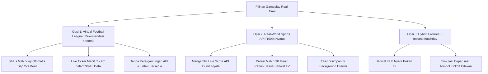

# ⚽ Dokumen Desain & Opsi Gameplay Sistem Parlay Sepak Bola

Dokumen ini menyajikan evaluasi mendalam, rumus matematika, pasar taruhan, serta **3 opsi mekanisme gameplay real-time** untuk sistem **Parlay Sepak Bola** pada proyek **Triliun Chip**.

---

## 1. Fondasi Logika & Rumus Matematika Parlay

### A. Rumus Akumulasi Murni (True Accumulator)
Berbeda dengan sistem rata-rata (*average odds*) atau taruhan terpisah (*split bundle*), parlay sejati menggunakan **perkalian kumulatif** dari seluruh odds leg yang dipilih:

$$\text{Total Multiplier} = \prod_{i=1}^{n} \text{Odds}_i = \text{Odds}_1 \times \text{Odds}_2 \times \dots \times \text{Odds}_n$$

$$\text{Potensi Kemenangan (Payout)} = \text{Taruhan (Stake)} \times \text{Total Multiplier}$$

#### Contoh Simulasi Payout:
| Pertandingan | Pilihan Pasar | Odds |
| :--- | :--- | :--- |
| Real Madrid vs Barcelona | Real Madrid Menang (1) | 2.10x |
| Man City vs Arsenal | Over 2.5 Gol | 1.85x |
| Inter Milan vs Juventus | Both Teams to Score (Ya) | 1.90x |
| Bayern Munchen vs Dortmund | Bayern Munchen Menang (1) | 1.65x |

* **Total Multiplier**: $2.10 \times 1.85 \times 1.90 \times 1.65 = \mathbf{12.16x}$
* **Taruhan**: $\$100,000$ TC
* **Potensi Payout**: $\$100,000 \times 12.16 = \mathbf{\$1,216,000\text{ TC}}$

---

### B. Aturan Menang / Kalah (Win Conditions)
1. **All-or-Nothing (Standar Internasional)**:
   - Seluruh leg ($n$ pertandingan) wajib menang 100%.
   - Jika ada **1 leg saja yang kalah**, tiket parlay dinyatakan **HANGUS**.
2. **Opsi Fitur Perlindungan: *Parlay Insurance*** *(Fitur Tambahan)*:
   - Jika pemain memasang 5 atau 6 leg, dan hanya **1 leg yang meleset** (misal 4 dari 5 tembus), pemain mendapatkan:
     - *Cashback* 100% dari modal taruhan, ATAU
     - Pembayaran parsial dari 4 leg yang tembus.

---

## 2. Variasi Pasar Taruhan Sepak Bola (Betting Markets)

Untuk memaksimalkan pengalaman sportsbook, pemain dapat memilih 3 pasar utama per pertandingan:

| Pasar | Deskripsi | Opsi Pilihan |
| :--- | :--- | :--- |
| **1X2 (Match Winner)** | Menebak hasil akhir pertandingan 90 menit | **1** (Home Win), **X** (Seri/Draw), **2** (Away Win) |
| **Over / Under 2.5 Gol** | Total gol kedua tim di atas atau di bawah 2.5 | **Over** (> 2.5 gol, min. 3 gol), **Under** (< 2.5 gol, maks. 2 gol) |
| **Both Teams To Score (BTTS)** | Kedua tim mencetak minimal masing-masing 1 gol | **Ya** (Skor min. 1-1, 2-1, dst), **Tidak** (Ada tim dengan skor 0) |

---

## 3. Tiga Opsi Gameplay Real-Time Pertandingan

Berikut adalah 3 opsi arsitektur gameplay untuk menghadirkan sensasi pertandingan dunia nyata:

---

### Opsi 1: Virtual Football League (Simulasi Terjadwal Cepat) — *Paling Direkomendasikan*
* **Konsep**: Mengadopsi mekanisme *Virtual Sports* di platform sportsbook modern (seperti SBOBET Virtual / Bet365 Virtual).
* **Alur Gameplay**:
  1. **Fase Taruhan (Betting Open)**: Pemain memiliki waktu 45 detik untuk meracik tiket dari jadwal matchday yang sedang dibuka (misal Pekan ke-14 Liga Champions).
  2. **Peluit Kick-Off**: Semua pertandingan dalam pekan tersebut dimulai serentak.
  3. **Live Match Ticker**: Pertandingan disimulasikan secara real-time dari menit **1' sampai 90' dalam durasi 30–45 detik**.
  4. **Komentar & Notifikasi Gol**: Tampil ticker komentar dramatis ("⚽ GOAL! 34' Erling Haaland!", "🟨 Kartu Kuning", "🧤 Penyelamatan Gemilang!").
  5. **Peluit Akhir & Payout**: Papan skor membeku di Full Time (FT) dan payout kemenangan langsung dicairkan.
* **Kelebihan**:
  - Selalu ada pertandingan kapan pun pemain membuka game (pagi, siang, malam).
  - Adrenalin tinggi dengan tempo cepat (tidak perlu menunggu 2 jam).
  - 100% mandiri, bebas kuota API luar, dan bebas isu CORS/koneksi.

---

### Opsi 2: Real-World Sports API (100% Mengikuti Pertandingan Nyata Dunia)
* **Konsep**: Mengintegrasikan API data sepak bola dunia nyata (misal: **Football-Data.org**, **API-Football / RapidAPI**, atau **TheSportsDB**).
* **Alur Gameplay**:
  1. Sistem menarik jadwal pertandingan nyata akhir pekan ini (Premier League, La Liga, Serie A, dll).
  2. Pemain memasang taruhan sebelum kickoff resmi di dunia nyata.
  3. Tiket tersimpan di `GameState.activeTickets` / LocalStorage.
  4. Saat pertandingan di dunia nyata sedang berlangsung (Sabtu/Minggu malam), game melakukan polling skor secara berkala.
  5. Setelah wasit di dunia nyata meniup peluit akhir, status tiket diselesaikan dan dana kemenangan dikirim ke akun pemain.
* **Tantangan**:
  - Pemain harus menunggu 90–100 menit asli untuk mengetahui hasil tiket.
  - Jika pemain bermain di hari kerja saat tidak ada jadwal bola, pasar taruhan akan kosong.
  - Kuota request API gratisan terbatas (misal 10 request/menit).

---

### Opsi 3: Hybrid Fixtures + Instant Matchday
* **Konsep**: Jadwal dan klub mengikuti data nyata pekan ini, namun waktu pertandingan disimulasikan secara instan ketika pemain menekan tombol taruhan.
* **Alur Gameplay**:
  1. Pemain melihat daftar pertandingan big-match dunia (El Clasico, Derby Manchester, dll).
  2. Pemain memilih 2-6 leg dan menentukan taruhan.
  3. Saat menekan tombol **"Kick-off"**, pertandingan langsung disimulasikan dalam waktu 15 detik dengan visual papan skor menit-per-menit.
* **Kelebihan**:
  - Pemain memiliki kontrol penuh atas kapan simulasi dimulai tanpa harus menunggu timer hitung mundur.

---

## 4. Fitur Unggulan Tambahan (Gameplay Enhancements)

1. **Fitur Cashout (Tarik Dana Awal)**:
   - Jika dari 4 pertandingan, 3 sudah menang dan pertandingan ke-4 sedang memasuki menit 75 dalam posisi unggul tipis, pemain bisa memilih tombol **Cashout** untuk mengambil 70-80% dari potensi kemenangan sebelum peluit akhir berbunyi.
2. **Integrasi Rate ON (Jackpot Volatility)**:
   - Jika pemain telah mencapai 250 putaran di kasino (`ratePlays >= 250`), peluang tim favorit menang dinaikkan secara drastis, memberikan peluang jackpot parlay yang sangat tinggi.

---

## 5. Ringkasan Rekomendasi
Untuk game santai dengan tempo bermain yang interaktif, **Opsi 1 (Virtual Football League)** memberikan keseimbangan terbaik antara sensasi *real-time matchday* yang menegangkan dan kepuasan instan para pemain. Opsi ini dapat diperkaya dengan data nama klub asli dan jadwal liga top Eropa.
